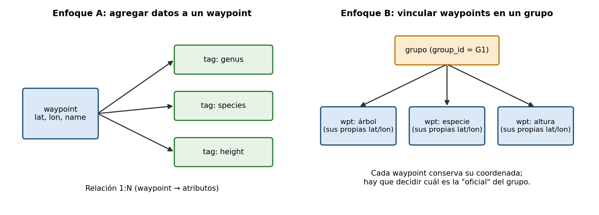
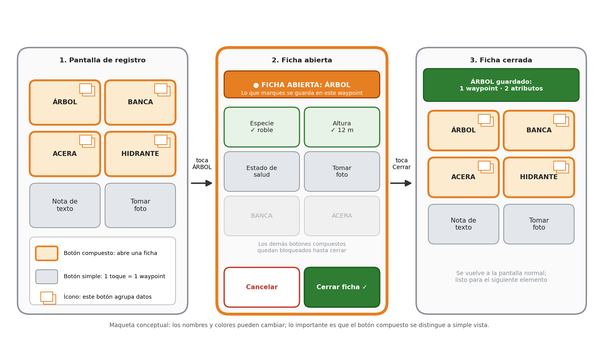
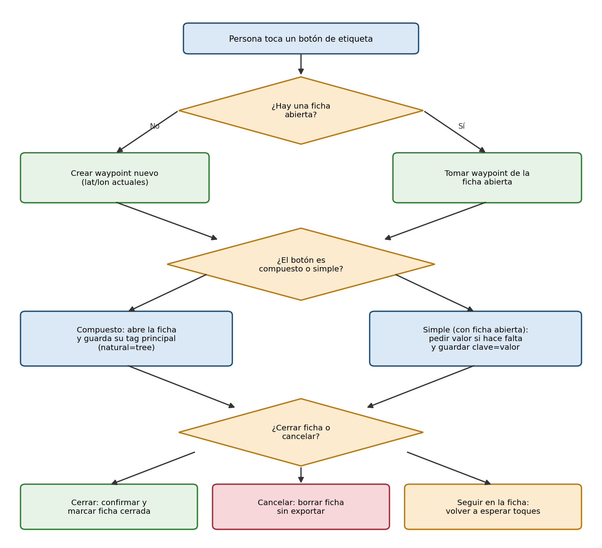
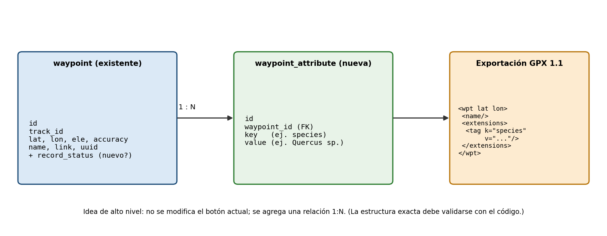

# 02 · Propuesta

## Enfoques
- **A. Agregar datos a un waypoint:** relación 1:N waypoint → atributos; exportación con `<extensions>` de GPX 1.1.
- **B. Vincular waypoints:** un `group_id` común; cada waypoint conserva su coordenada.

## Elegido: A (ficha de elemento)
Justificación: concepto claro (elemento con atributos), una sola coordenada, coherente con nodos OSM, compatible hacia atrás con el comportamiento actual.

## Dos tipos de botones
- **Botón simple** (como hoy): gris. Sin ficha abierta crea un waypoint propio; con ficha abierta agrega su dato a la ficha.
- **Botón compuesto** (nuevo): color naranja, borde grueso e ícono de "hojas apiladas". Crea un waypoint y abre una ficha.
- Con ficha abierta: banner naranja "FICHA ABIERTA: <elemento>", marco de pantalla naranja, datos ya capturados marcados con ✓ y los demás botones compuestos bloqueados. Salidas: "Cerrar ficha" o "Cancelar".

## Flujo de interacción
1. La persona toca un **botón compuesto** (p. ej. "Árbol") → se abre una **ficha** y se crea un waypoint.
2. Cada botón de atributo que toque se agrega a esa ficha (clave=valor).
3. "Cerrar ficha" confirma y guarda; "Cancelar" descarta.
4. Sin ficha abierta, la app se comporta como hoy.

## Estructura de datos (conceptual)
- `waypoint` (existente) + relación 1:N con `waypoint_attribute(id, waypoint_id, key, value)`.
- Exportación: `<wpt><extensions><tag k="..." v="..."/></extensions></wpt>`.

## Cambio en los términos
"Capturar un punto" → "abrir y completar una ficha". Waypoint = elemento mapeado.

## Diagramas

